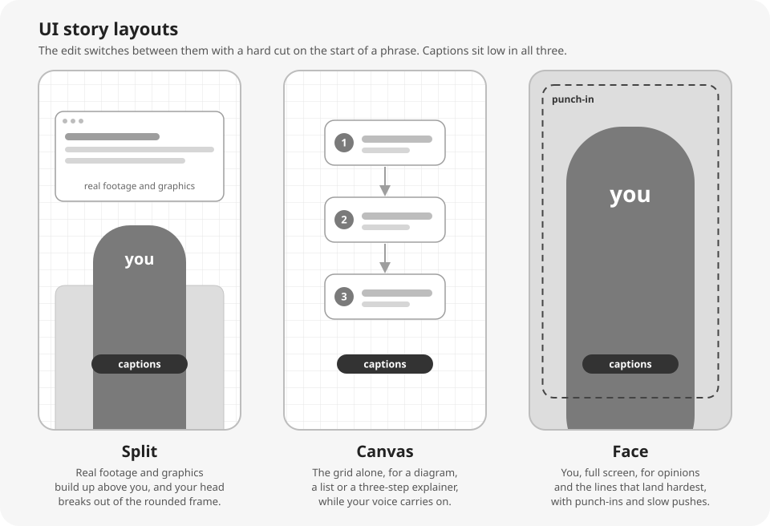
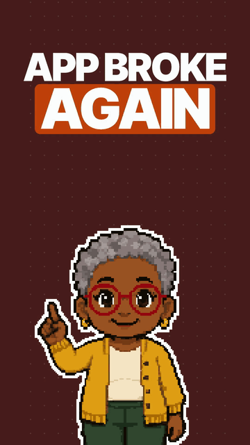

# Content Intelligence Kit

## What it does

The kit is a set of skills for Claude Code and Codex that research, plan, edit, check and post short vertical videos (Reels, TikToks and Shorts) in your own brand and voice. You run it by talking to your agent inside this folder. Say "run my research" or "here's my raw take, edit it", and the skill for that job does the work. You never type a slash command.

The first conversation sets the kit up for you. It checks your Mac, learns your brand, your voice, your audience and the creators you want to learn from, and ends with a short test clip in your colours. Everything it learns about you lives in your own folder, `me/`, which kit updates never touch.

## What's included

Version 1 has five parts (onboarding, research, the UI story and mini me video styles, and posting through Zernio), plus feedback and updates.

| Part | You say | You get |
| --- | --- | --- |
| Onboarding | "set me up" | your brand, voice, audience, watch list and character files, a checked Mac, and a test clip in your brand |
| Research | "run my research", then "give me hooks for number 2" | a report on what is working for the creators you watch, with each video scored against that creator's usual engagement and a ranked list of ideas, then hook options for the idea you pick |
| UI story | "plan the video for number 2", then "here's my raw take, edit it" | talking points and a film guide in your voice, then the finished Reel made from your take |
| Mini me | "make number 3 a mini me video" | a narration in your voice, the voice-over, and a finished faceless Reel |
| Posting through Zernio | "post it everywhere tomorrow at 6pm" | a caption for each platform to approve, then the Reel scheduled on Instagram, TikTok, YouTube Shorts, Facebook, LinkedIn and X |
| Feedback | "the captions are too long, fix that going forward" | the fix, plus a rule in your rules file that every later video follows |
| Update | "update the kit" | the latest kit files, with your own files left alone |

Both video styles run quality checks and a visual review before a Reel counts as done. "What's next" tells you the next step for the video you are working on. Without a Zernio key, every Reel still ends with the MP4 and one file with each platform's caption, ready to post by hand.

### UI story

UI story is for talking-head Reels. You film yourself talking, and the edit puts the real thing you talk about on screen as you say it: footage of a product in use, its interface, a chart or a post. It cuts between three layouts:



A new visual lands about every two seconds, the captions light up word by word in your fonts, and motion graphics come in your accent colour. The Reel closes on your call to action and plays at 1.15x speed. The kit ships no music, so a bed plays under the Reel only once you add tracks you have the right to use.

### Mini me

Mini me needs no filming. A pixel character of you, drawn from 3 to 5 photos or from a description, does the talking. You approve the character sheet and then each pose. In the video it stands big and cropped at the waist, takes a new pose on every page, and each spoken phrase lands as a giant keyword headline in your colours. The voice-over is your own phone recording, which is free, or an ElevenLabs voice with your key.

[](docs/media/mini-me-example.mp4)

A test Reel the kit made for a made-up creator. The loop links to the whole Reel, with its sound.

## Not included

Version 1 leaves out:

- comment-to-DM rules
- email capture and resource pages
- an analytics dashboard and a weekly performance review
- other edit styles and script methods, clips, plain motion graphics, carousels and thumbnails
- a standalone script skill (script writing lives inside the two video styles)
- Slack as a research input
- Cowork, which cannot run the video renders
- Windows, Linux and Intel Macs: setup stops on them

## What you need

- A Mac with Apple silicon (M1 or newer). The kit is built and tested on these Macs, and setup stops on any other computer.
- At least 20 GB of free disk space. Setup downloads a few gigabytes of tools, and renders need room while they run. The machine check warns below 20 GB and stops below 5 GB.
- Claude Code on a Claude Max plan for the two video styles, because a UI story edit or a mini me build is one long agent run. Codex works too. It was tested on ChatGPT Pro at US$100 a month (October 2026).
- An internet connection during setup.
- Optional keys for Apify, an image model, ElevenLabs and Zernio. Each tool has a free way round it, and [Costs](#costs) lists rough prices.

Setup takes care of the rest and asks before each install: Homebrew, ffmpeg, uv with Python 3.11, Node 22 or newer, HyperFrames with `npm ci`, Chromium, GSAP, and the Python tools, which include speech to text and yt-dlp. The matting model downloads the first time a video needs it. Run `python3 bin/doctor.py` at any time to see where your Mac stands. It changes nothing.

### How the install is tested

Before each release:

- A smoke job, `.github/workflows/smoke.yml`, installs the kit on a fresh GitHub macOS runner with an Apple silicon chip and renders a three second card. On the runner it installs ffmpeg with Homebrew, Python 3.11 and the Python tools (yt-dlp among them) with uv, HyperFrames with `npm ci`, Chromium and GSAP, then runs the machine check and the tests.
- The whole kit runs end to end as a made-up creator, in Claude Code and in Codex: onboarding, research, both video styles and a posting dry run.

## Quick start

```bash
git clone https://github.com/Richardeve1997/content-intelligence-kit
cd content-intelligence-kit
```

On a new Mac, `git clone` first asks to install Apple's command line developer tools. Say yes, and run both commands again once they are installed.

Open the folder in Claude Code or Codex by running `claude` or `codex` inside it, then say "set me up". Setup is one conversation of 30 to 45 minutes. It asks about one thing at a time and saves after every step, so you can stop and pick it up later. [ONBOARDING.md](ONBOARDING.md) walks through each step.

### Clone it, don't fork it

GitHub keeps a fork of a public repository public, and you cannot make it private. Your copy will hold your voice samples, photos and scripts. They sit in folders git ignores, but anything you ever commit to a fork is public for anyone to read. So clone the kit as above, or press "Use this template" on GitHub and make the new repository private.

## Costs

Apart from your Claude or ChatGPT plan, every paid tool is optional, and each has a free way round it. Keys go in `.env`, which git ignores. The prices below come from each provider's pricing page on 28 October 2026. They change, so check them before you sign up.

| Tool | What the kit uses it for | Rough cost (28 October 2026) | Without it |
| --- | --- | --- | --- |
| Apify (`APIFY_TOKEN`) | research on Instagram and TikTok creators | a free plan with US$5 of usage a month, on which the official Instagram scraper costs about US$2.70 per 1,000 results. The kit caps each research run at US$0.25 for Instagram and US$0.50 for TikTok, and you can raise the caps. | YouTube creators through yt-dlp, and links you paste |
| An image model (`OPENAI_API_KEY`, `GEMINI_API_KEY` or a signed-in Codex CLI) | drawing your mini me character and its poses | priced per image by OpenAI or Google, while a signed-in Codex CLI uses your ChatGPT plan. A character takes 9 images, plus one for each redraw. | the kit prints the prompts, you paste them into ChatGPT or Gemini, and you save the pictures into a folder |
| ElevenLabs (`ELEVENLABS_API_KEY`) | a stock or cloned voice for mini me | instant voice cloning starts on the Starter plan, about US$5 to 6 a month | record the voice-over on your phone |
| Zernio (`ZERNIO_API_KEY`) | scheduling posts on six platforms, and your own results as a research input | priced per connected account: the first 2 are free, then US$6 a month each for accounts 3 to 10, so all six platforms come to about US$24 a month | post the MP4 by hand, with the caption file the kit writes |

## Codex

Codex reads `AGENTS.md`, which points it to `CLAUDE.md`, and it finds the same skills through `.agents/skills`, a link to `.claude/skills`. The kit sets up no hooks for Codex, so Codex runs the start-of-session check itself, and each skill records your corrections in its own Feedback step. In Codex the video styles need a paid ChatGPT plan, as they need Claude Max in Claude Code.

Codex usually runs commands in a sandbox that can write only in this folder and the temporary folder, and cannot reach the internet. Rendering video, installing tools, research, voice-overs and posting cannot run there, so for those steps Codex asks before it runs a command outside the sandbox. Say yes when it asks.

## Updating

Say "update the kit". It checks how your copy was made first:

- A clone of this repository updates with `git pull`. Your folders (`me/`, `work/` and `research/`) and `.env` are gitignored, so a pull leaves them alone.
- A copy made with "Use this template", a clone pointed at your own repository, or an unzipped download updates from the latest release through `bin/update_kit.py`. It shows what would change before it changes anything. A kit file you edited stays as you left it unless the release changed it too, and then your version is copied to `me/kit-backups/` before it is replaced.

When a release changes the dependencies, the update says so and names the commands to run: `uv sync --group video --group research --inexact`, then `npm ci`.

### This repo takes no pull requests

Pull requests are turned off for this repository, because the kit has one maintainer and takes no changes from anyone else. Clone it and make it yours instead. Edit anything in your copy, and keep lasting preferences as rules (say "going forward"), which updates never undo.

## Credits

Built by Richard Eve ([@artofthepossible.ai](https://www.instagram.com/artofthepossible.ai/)).

The kit is released under the MIT licence, in `LICENSE`. The fonts, tools and models it uses come from other projects under their own licences, listed in [THIRD_PARTY.md](THIRD_PARTY.md).
